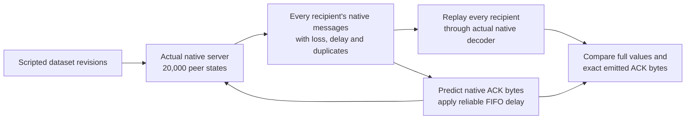

# Native 20,000-peer proof

The selected fixture runs the published Replicon 0.45.2 server with 20,000 native
connected and authorized peer identities at once. Every recipient's complete trace
is then replayed through an actual native client App. This is a deterministic
protocol simulation; it is not 20,000 live sockets or 20,000 client Apps resident
on this computer simultaneously.

The earlier direct fixture passed 48 processes at 1/8/64/512 client Apps, with
full and native-diff replication, message faults, and ordered ACK delays of
0/4/24 frames. Its 512-client peak was approximately 350 MiB. Extrapolating that
whole-client setup to 20,000 would exceed this host's 8 GiB RAM. That is a harness
resource limit, not proof that the native server cannot serve 20,000 clients.

The handshake packets come from a native prototype. Every independent replay
must reproduce them exactly. The ACK predictor reads only the mutation flags and
fixed two-byte mutation index from the pinned native header; it does not decode
or copy authoritative application values into a receiver. No run succeeds until
all native replays emit the exact predicted client messages at every logical
step and reconstruct complete application values from the recorded server bytes.
At each server ACK-delivery step, the corresponding packet target must already
be reflected in the replayed application state. This matters because Replicon's
native ACK contract otherwise means parsed/retained, not necessarily applied.

For a successful run, the replay checks establish the feedback trace by induction:
the native handshake is identical, and each native client response to the recorded
server prefix is identical to the response supplied on that connection's FIFO
schedule. The fixed 16,666,667 ns clock keeps simulation time independent of how
long oracle execution takes. These fixtures have receive-only clients plus ACKs;
they do not include interactive player input or deferred application observers.

The full/native-diff × sync/faulted-delivery × 0/4/24-frame ACK-delay grid passed
all **12 processes at 20,000 server peers**. Together they performed **240,000
native client replays** and **12,080,000 complete-value checks and exact ACK-frame
checks**. The corresponding 48-process smaller replay grid also passed.

Raw records and coverage audits live in `evidence/native-replay-v4-20k/` and
`evidence/native-replay-v4-20k-audit.json`. Source, lockfile, compiler, flags and
executable bindings live in `evidence/native-replay-v4-build.json`.

Server updates, application mutation, exported trace handling, ACK prediction and
decoder replay have separate timing fields. Process CPU/RSS includes setup,
retained traces and oracle execution. The 20,000-peer process peaks ranged from
about 450 to 3,545 MiB; this is **not native-library-only memory**. These two-worker
observations ran alongside other work. There are no isolated paired performance
intervals, end-to-end latency results or accepted speed comparisons yet.

Rill's new `wire` module supplies a real application-message boundary: canonical
attempt/revision/baseline varints, a transport-bound session, ACK attempt IDs and
borrowed payload decoding. Contiguous output and stack-header/shared-body I/O
slices are both available. The next comparison must charge actual framing,
codec and ACK work on both sides. Native `Diffable` consumes authored changes;
that mode needs a matching Rill change-feed input, not a snapshot-only competitor
artificially forced to rediscover changes. Snapshot and authored-change layers,
broader payloads/scopes, other engines, memory accounting and final statistics
remain open. No library is claimed universally faster.
